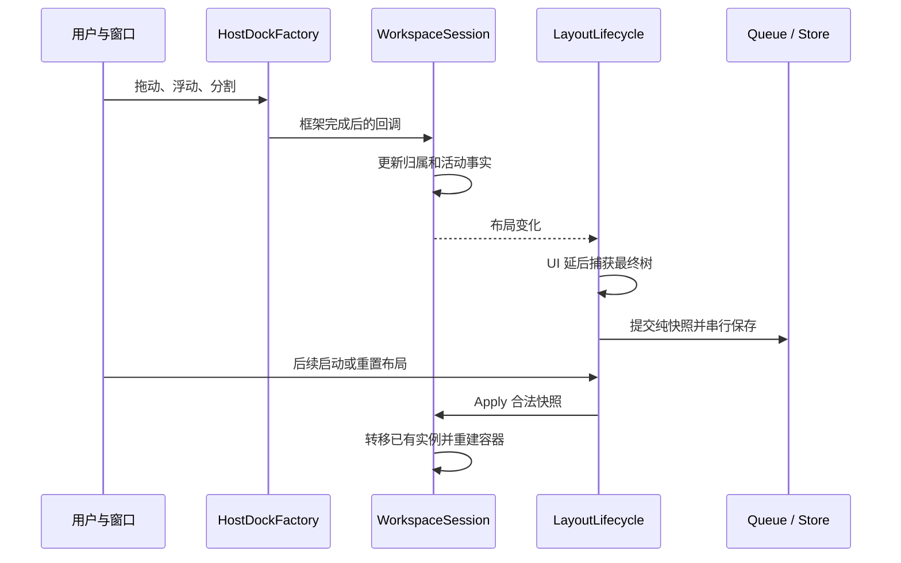

# 场景：浮动页面、移动窗口、保存与恢复布局

> 核对日期：2026-09-28。本篇串联当前实现；局部机制、源码和验证入口见文内下钻链接。

[上层：跨模块流程](README.md) · [文档总览](../README.md)

## 场景边界

当前运行中把文档移到浮窗，需要保留原模型、View 和 Scope。跨启动布局恢复保存工具结构与文档占位，不承诺重新打开上次真实 Document。

## 控件迁移的两层保护

DocumentControlRecycling 保证同一个文档正文的实例与父级关系；Avalonia 补丁保证控件迁走后旧根布局队列不会错误处理它。只处理其中一层，仍可能出现跨窗异常。

## 保存与恢复的区别

保存时树投影剔除真实文档，合并空分支，保留工具位置、显隐和不可用项纯记录。恢复时先校验整个快照，再建立候选容器，转移现有对象。失败用 TransferCheckpoint 回到原集合与窗口，不能通过重建业务对象伪装回滚。

主窗退出前先冻结并保存最终布局，再拆除浮窗。用户取消退出则恢复捕获。最后一个工具的关闭还要尊重原生窗口否决，不能先隐藏内容。

继续放大：[控件与 Adapter](../05-docking-layout/01-adapters-and-views.md)、[布局恢复](../05-docking-layout/03-snapshot-store-and-restore.md)、[保存关闭](../05-docking-layout/04-save-queue-and-close.md)。验证：[DockCrossWindowLayoutUiTests](../../../Host/MyAvaloniaManagement.UiTests/DockCrossWindowLayoutUiTests.cs)、[DockLayoutV3UiTests](../../../Host/MyAvaloniaManagement.UiTests/DockLayoutV3UiTests.cs)、[DockToolWindowCloseUiTests](../../../Host/MyAvaloniaManagement.UiTests/DockToolWindowCloseUiTests.cs)。
