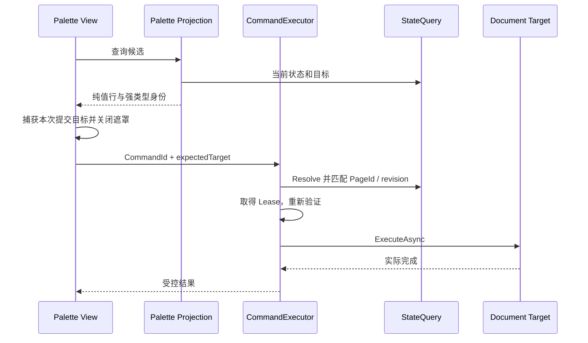

# 场景：从命令面板执行当前页面的命令

> 核对日期：2026-09-28。本篇串联当前实现；局部机制、源码和验证入口见文内下钻链接。

[上层：跨模块流程](README.md) · [文档总览](../README.md)

## 场景与目标

用户打开命令面板，看到当前页面的一条插件命令，然后提交。在搜索和提交之间活动页面可能改变，因此展示目标必须成为本次调用的约束。

## 页面切换为什么必须拒绝旧提交

如果面板显示的是 A 页命令，提交前切到 B 页，不能套用菜单“对当前页执行”的语义去操作 B。expectedTarget 随本次调用传入 Executor，命令共享对象仍可被菜单和快捷键复用。

取得 Lease 后还要核对当前实例及 owner，CanExecute 之后也再次检查。一次 UI 查询不足以提供执行许可。

## 四类候选不要混用执行器

本篇针对普通 Command。功能候选走创建用例；页面候选按 PageId 激活；工具候选走 ToolCenterActions。功能创建成功后才关闭遮罩，普通命令先关闭再执行。页面已失效时不匹配同名页面兜底。

源码：[PaletteProjection](../../../Host/MyAvaloniaManagement/Business/Presentation/Commands/WorkbenchCommandPaletteProjection.cs)、[TargetExpectation](../../../Host/MyAvaloniaManagement/Business/Commands/Context/WorkbenchCommandTargetExpectation.cs)、[Executor](../../../Host/MyAvaloniaManagement/Business/Commands/Execution/WorkbenchCommandExecutor.cs)。放大：[命令目标机制](../06-commands/02-context-and-execution.md)、[呈现](../06-commands/04-presentation-and-palette.md)。验证：[CommandPaletteV18TargetTests](../../../Host/MyAvaloniaManagement.Tests/CommandPaletteV18TargetTests.cs)、[CommandPaletteV18UiTests](../../../Host/MyAvaloniaManagement.UiTests/CommandPaletteV18UiTests.cs)。
