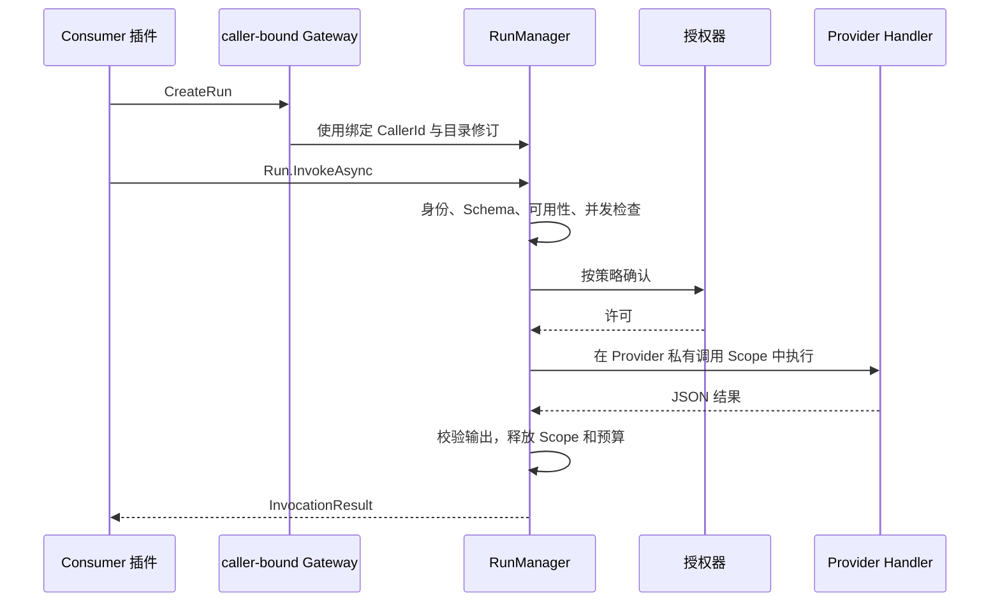

# 场景：插件调用另一个插件的 Workflow Action

> 核对日期：2026-09-28。本篇串联当前实现；局部机制、源码和验证入口见文内下钻链接。

[上层：跨模块流程](README.md) · [文档总览](../README.md)

## 场景与成功条件

Consumer 使用 Host 注入的 Gateway 创建 Run，选择 Provider 的 Action 并提供 JSON。成功意味着 Handler 实际结束、输出通过校验并返回结构化成功；仅授权通过或 Scope 创建完成都只是中间阶段。

## 跨边界传什么

消费者只提交 ActionId 与 JSON 参数等契约信息，不能选择另一个 CallerId 或取得提供者 Provider。Handler 得到可信调用上下文和取消令牌，不需要当前工作区活动文档。

一次 Run 可组织多个调用，但每次执行 Scope 仍独立。Run 的确认复用与并发预算不改变 Handler 服务的容器所有者。

## 失败路径

自调用与嵌套调用在执行前拒绝；输入不合法、并发超限、授权拒绝均不应执行 Handler。Handler 抛异常或输出不合法返回受控失败。时间预算只发协作取消，忽略取消的 Handler 仍须保持 Scope 有效。

Host 退出时所有调用的真实结束由 RunManager 统计，未排空则阻止 Provider 释放。

源码：[WorkflowActionRuntime](../../../Host/MyAvaloniaManagement/Business/WorkflowActions/WorkflowActionRuntime.cs)、[PluginProviderOwner](../../../Host/MyAvaloniaManagement/Business/Plugins/Registration/PluginProviderOwner.cs)。放大：[授权与 Scope](../07-workflow-actions/02-invocation-and-authorization.md)、[预算与退出](../07-workflow-actions/03-budgets-and-shutdown.md)。验证：[WorkflowActionG1IntegrationTests](../../../Host/MyAvaloniaManagement.PluginTests/WorkflowActionG1IntegrationTests.cs)。
