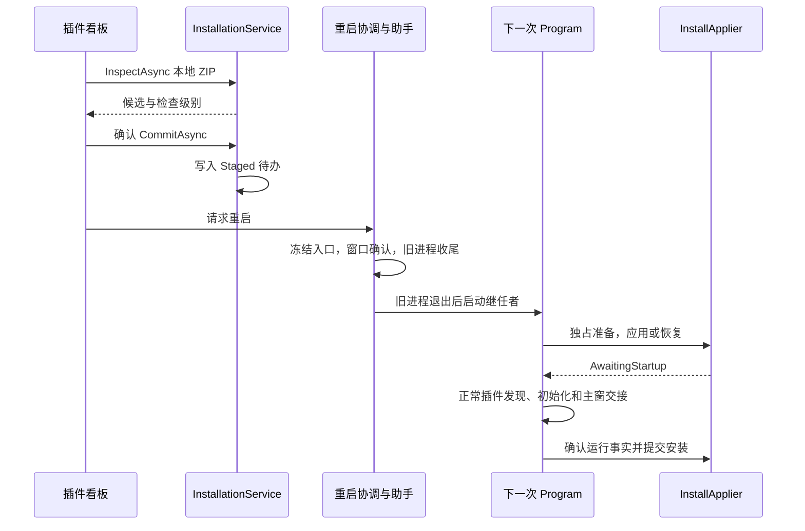

# 场景：检查本地插件包并重启应用更新

> 核对日期：2026-09-28。本篇串联当前实现；局部机制、源码和验证入口见文内下钻链接。

[上层：跨模块流程](README.md) · [文档总览](../README.md)

## 场景分成两次进程运行

## 第一次运行中确认什么

包检查确认规范结构、身份、SDK 和产物约束；可选配套清单增加摘要核对。预览来自专属输入快照。提交时重新核对候选与当前磁盘基线，同版重装或降级需要应用自身的明确确认规则。

提交只形成待办，当前 DLL 和本次插件运行列表保持原事实。关闭看板不撤销服务已经接受的提交。

## 进程交接为什么放在中间

重启复用文档关闭确认及最终布局保存。任何可撤销阶段失败都保留旧工作台和待办，由用户之后继续。助手不搬目录，只等旧进程退出并创建一次新 Host。

## 第二次运行中确认什么

InstallationSession 在发现前取得租约，Applier 先写恢复意图再替换完整目录。主窗交接后，启用且可用的插件确认 startupConfirmed；禁用插件确认 installedDisabled，而非伪造生命周期已执行。

失败或进程中断留下可恢复日志，后续独占启动根据摘要恢复。未知内容和坏备份不会被盲目覆盖。详细故障分支见[安装机制](../02-plugins/05-installation-and-recovery.md)。

源码：[InstallationService](../../../Host/MyAvaloniaManagement/Business/Plugins/Installation/PluginInstallationService.cs)、[InstallationSession](../../../Host/MyAvaloniaManagement/Business/Plugins/Installation/PluginInstallationSession.cs)、[Program](../../../Host/MyAvaloniaManagement/Program.cs)。验证：[PluginInstallationProcessTests](../../../Host/MyAvaloniaManagement.PluginTests/PluginInstallationProcessTests.cs)、[HostRestartProcessTests](../../../Host/MyAvaloniaManagement.PluginTests/HostRestartProcessTests.cs)。
