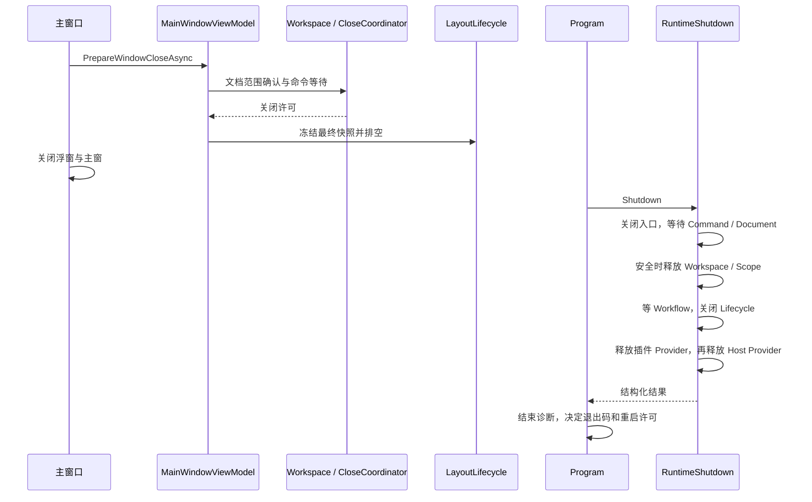

# 场景：退出 Host 并安全释放对象图

> 核对日期：2026-09-28。本篇串联当前实现；局部机制、源码和验证入口见文内下钻链接。

[上层：跨模块流程](README.md) · [文档总览](../README.md)

## 两段关闭

第一段是用户可撤销的工作台关闭：文档确认、命令等待和最终布局保存。第二段是 Runtime 与进程收尾：关闭新入口、证明在途调用结束、生命周期停止、容器与日志释放。

## 为何不能靠窗口 Closed 完成全部清理

窗口只说明呈现寿命结束。在途 Workflow、功能中心触发的初始化、插件取消回调都可能仍访问服务。Runtime 需要各模块的真实排空结论；单个窗口不能安全决定整个插件容器的寿命。

主窗保存必须早于浮窗拆除。布局拆除通知如果进入未冻结的自动保存队列，会把最后布局覆盖成退出中的临时结构。

## 取消和失败

文档确认取消、保存失败或最终布局准备失败时，恢复工作区与布局入口。进入最终收尾后不能重新用 DI 解析清理对象；ShutdownParticipants 只使用此前已建立的实例。

若调用未结束或生命周期不能安全停止，Runtime 保留必要对象图并返回失败。Program 结束日志后再决定重启最终许可，不能只凭“主窗口关了”就启动新进程。

源码：[MainWindowViewModel](../../../Host/MyAvaloniaManagement/ViewModels/MainWindowViewModel.cs)、[RuntimeShutdown](../../../Host/MyAvaloniaManagement/Business/Composition/HostRuntimeShutdown.cs)、[Program](../../../Host/MyAvaloniaManagement/Program.cs)。放大：[关闭回滚](../01-runtime/02-shutdown-and-rollback.md)、[所有权矩阵](../11-reference/02-ownership-and-threading.md)。验证：[HostLifecycleOwnershipTests](../../../Host/MyAvaloniaManagement.PluginTests/HostLifecycleOwnershipTests.cs)、[DocumentOperationShutdownTests](../../../Host/MyAvaloniaManagement.Tests/DocumentOperationShutdownTests.cs)。
