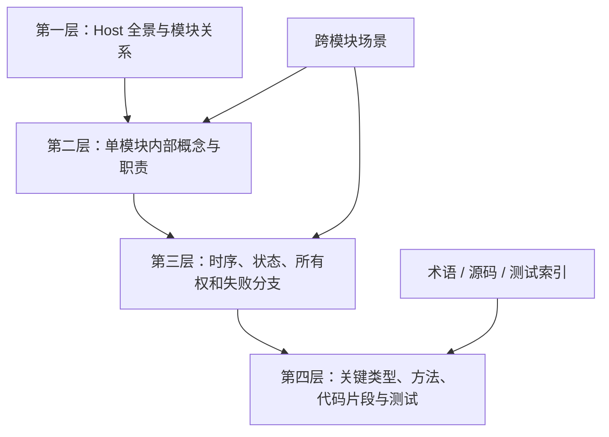

# Host 架构：从全景到源码

> 用途：逐层理解当前 Host 的概念、协作、运行机制与关键代码。核对日期：2026-09-28。依据：当前工作树源码、现行契约及各篇所列测试。本文档组不代表新的功能实现、部署或发布结论。

[返回主仓文档导航](../README.md) · [原 Host 架构说明](../../Host/MyAvaloniaManagement/docs/design/architecture.md)

## 从这里开始

这套文档按“Host 全景 → 模块内部 → 运行机制 → 关键代码与测试”逐层展开。先建立概念，再选择一个模块放大，最后沿一次真实操作串起调用链。编号是推荐阅读顺序，不是产品版本。

## 三条阅读路线

- **初次理解 Host**：[系统边界](00-overview/01-system-boundary.md) → [核心概念](00-overview/02-core-concepts.md) → [模块地图](00-overview/03-module-map.md) → [一次运行](00-overview/04-runtime-story.md) → [源码地图](00-overview/05-codebase-map.md)。
- **理解主干实现**：[运行时](01-runtime/README.md) → [插件](02-plugins/README.md) → [工作区](03-workspace/README.md) → [文档](04-documents/README.md) → [Dock 与布局](05-docking-layout/README.md)，再读命令、Workflow 与呈现。
- **带着问题查代码**：从[跨模块场景](10-end-to-end/README.md)选用户动作，沿机制链接下钻；已知类型名时直接查[源码索引](11-reference/03-code-index.md)和[测试索引](11-reference/04-test-index.md)。

## 本组覆盖什么

核心是 Host 当前实现。SDK 作为边界解释，MyPlugTest 和测试夹具作为验证入口，外部业务插件不展开内部领域。文档重点讲关键协调逻辑、提交点、取消、并发和资源所有权；普通属性和简单数据类型按需索引。

现有 docs/reference 继续维护权威文件格式、SDK 与对外行为；本组解释它们如何在代码中实现。历史计划仅用于理解既有决策，不把未实施内容写成当前能力。原 Host 架构路径保留，应用帮助通过文档链接进入本组。

## 模块导航

| 模块 | 主要问题 |
| --- | --- |
| [运行时](01-runtime/README.md) | 谁组合对象，何时 Ready，失败和退出怎样收尾 |
| [插件体系](02-plugins/README.md) | 发现、注册、容器、可用性、启用与安装 |
| [工作区](03-workspace/README.md) | 目录如何变成页面，目标与工具显隐如何管理 |
| [文档](04-documents/README.md) | 创建、打开、保存、恢复、关闭、Scope |
| [Dock 与布局](05-docking-layout/README.md) | Adapter、控件、窗口、快照和恢复 |
| [工作台命令](06-commands/README.md) | 声明、上下文、执行、取消及界面投影 |
| [Workflow Action](07-workflow-actions/README.md) | 身份、Schema、授权、调用 Scope 和预算 |
| [界面呈现](08-presentation/README.md) | Shell、MVVM、窗口会话、主题图标及帮助 |
| [支撑能力](09-infrastructure/README.md) | 文件事务、诊断、兼容证据及框架补丁 |

## 完整阅读目录

### 00-overview · Host 全景

- [系统边界：Host、插件、SDK 与框架](00-overview/01-system-boundary.md)
- [核心概念：先分清声明、实例、呈现和所有权](00-overview/02-core-concepts.md)
- [Host 模块地图：职责与交互](00-overview/03-module-map.md)
- [从启动到退出：一次 Host 运行的故事](00-overview/04-runtime-story.md)
- [源码地图：从概念找到工程和代码](00-overview/05-codebase-map.md)

### 01-runtime · 运行时

- [运行时：组合、启动、退出与重启](01-runtime/README.md)
- [启动与组合：Prepared 为什么还不是 Ready](01-runtime/01-startup-and-composition.md)
- [关闭与回滚：先证明可以释放](01-runtime/02-shutdown-and-rollback.md)
- [自动重启：请求、许可和跨进程交接](01-runtime/03-restart-handoff.md)

### 02-plugins · 插件体系

- [插件体系：从磁盘文件到可用能力](02-plugins/README.md)
- [发现与加载：先识别，再执行插件代码](02-plugins/01-discovery-and-loading.md)
- [注册与容器：声明提交和实例激活分开](02-plugins/02-registration-and-containers.md)
- [生命周期与可用性：注册成功之后仍有运行阶段](02-plugins/03-lifecycle-and-availability.md)
- [插件启用设置：当前事实与下次意图](02-plugins/04-enablement.md)
- [本地 ZIP 安装：预览、事务日志与下次启动恢复](02-plugins/05-installation-and-recovery.md)

### 03-workspace · 工作区

- [工作区：声明如何变成运行中的页面和工具](03-workspace/README.md)
- [目录、会话与激活：五种角色的分工](03-workspace/01-catalog-session-activation.md)
- [页面身份、创建目标与即时查询](03-workspace/02-pages-targets-and-queries.md)
- [工具显隐：复用实例与空间位置恢复](03-workspace/03-tools-and-visibility.md)

### 04-documents · 文档

- [文档模块：创建、持久化、关闭和释放](04-documents/README.md)
- [文档概念：激活、内容、修订和持久化状态](04-documents/01-concepts.md)
- [文档内部结构：协调器、状态与资源所有者](04-documents/02-internal-structure.md)
- [创建与激活：成功初始化以后才让页面可见](04-documents/03-create-and-activate.md)
- [文件打开与恢复：候选准备完成后再询问](04-documents/04-open-and-restore.md)
- [保存与修订：主文件提交以后不能倒写结果](04-documents/05-save-and-revision.md)
- [关闭与释放：许可、等待、复核和框架重入](04-documents/06-close-and-release.md)
- [文档所有权与并发：一个 Scope 和两个等待边界](04-documents/07-ownership-and-concurrency.md)
- [文档源码导读与验证地图](04-documents/08-code-and-tests.md)

### 05-docking-layout · Dock 与布局

- [Dock 与布局：框架适配、空间结构与持久化](05-docking-layout/README.md)
- [Adapter 与 View：普通模型如何进入 Dock](05-docking-layout/01-adapters-and-views.md)
- [布局树与窗口：稳定骨架、浮动内容与位置](05-docking-layout/02-tree-windows-and-placement.md)
- [布局快照与恢复：纯数据描述空间，实例继续复用](05-docking-layout/03-snapshot-store-and-restore.md)
- [布局保存与关闭：捕获时机和最终冻结](05-docking-layout/04-save-queue-and-close.md)

### 06-commands · 工作台命令

- [工作台命令：声明、当前目标、执行和界面投影](06-commands/README.md)
- [命令声明与绑定：目录不持有业务执行对象](06-commands/01-catalog-and-bindings.md)
- [上下文与执行：防止命令落到另一张页面](06-commands/02-context-and-execution.md)
- [命令租约与退出：执行完毕才能释放页面](06-commands/03-leases-and-shutdown.md)
- [命令呈现：菜单、快捷键和四类搜索结果](06-commands/04-presentation-and-palette.md)

### 07-workflow-actions · Workflow Action

- [Workflow Action：受治理的跨插件能力调用](07-workflow-actions/README.md)
- [Workflow 目录与契约：调用者身份和固定目录修订](07-workflow-actions/01-contracts-and-catalog.md)
- [Workflow 调用：先治理，后进入 Provider Scope](07-workflow-actions/02-invocation-and-authorization.md)
- [Workflow 预算与退出：超时不会强杀插件](07-workflow-actions/03-budgets-and-shutdown.md)

### 08-presentation · 界面呈现

- [界面呈现：窗口、绑定、功能入口与帮助](08-presentation/README.md)
- [主窗口与绑定：谁协调 UI，谁拥有业务状态](08-presentation/01-shell-and-bindings.md)
- [功能中心、工具中心与插件看板：查询和操作分开](08-presentation/02-centers-and-dashboard.md)
- [主题、图标与帮助：Host 统一呈现的支撑机制](08-presentation/03-appearance-icons-help.md)

### 09-infrastructure · 支撑能力

- [支撑能力：存储、诊断、兼容性和框架补丁](09-infrastructure/README.md)
- [存储与原子事务：单文件提交和上层业务提交](09-infrastructure/01-storage-and-transactions.md)
- [诊断与错误边界：草稿如何成为可保存记录](09-infrastructure/02-diagnostics-and-errors.md)
- [兼容性与框架补丁：契约、产物身份和验证证据](09-infrastructure/03-compatibility-and-patches.md)

### 10-end-to-end · 跨模块流程

- [跨模块流程：沿一次真实操作读完整个 Host](10-end-to-end/README.md)
- [场景：启动 Host 并显示可用工作台](10-end-to-end/01-startup.md)
- [场景：从功能入口新建插件 Document](10-end-to-end/02-create-document.md)
- [场景：打开文件、修改、保存并关闭](10-end-to-end/03-open-save-close.md)
- [场景：浮动页面、移动窗口、保存与恢复布局](10-end-to-end/04-floating-and-layout.md)
- [场景：从命令面板执行当前页面的命令](10-end-to-end/05-command-palette.md)
- [场景：插件调用另一个插件的 Workflow Action](10-end-to-end/06-workflow-call.md)
- [场景：检查本地插件包并重启应用更新](10-end-to-end/07-install-and-restart.md)
- [场景：退出 Host 并安全释放对象图](10-end-to-end/08-shutdown.md)

### 11-reference · 查找与维护

- [术语表：从名词跳回机制](11-reference/01-glossary.md)
- [所有权、线程与提交点矩阵](11-reference/02-ownership-and-threading.md)
- [源码索引：从类型反查架构机制](11-reference/03-code-index.md)
- [测试索引：按架构风险查找验证](11-reference/04-test-index.md)
- [文档维护：层级、证据和变更范围](11-reference/05-maintaining-this-guide.md)

## 如何维护

模块正文先说明概念和图示，再给关键代码、边界与测试。图里的关系不自动表示容器所有权；每篇会说明所画的是依赖、运行时交接还是释放责任。具体约定见[维护说明](11-reference/05-maintaining-this-guide.md)，建设顺序和完成标准也集中在那里。

源码链接在仓库阅读器或编辑器中使用。安装版帮助可浏览根 docs、Host 内部 docs 及根 README 的嵌入 Markdown；SDK 包、Packaging 和 patches 下的 README 与 C# 源码需要在仓库阅读。引用测试是验证导航，实际运行与人工验收应分别留证。
